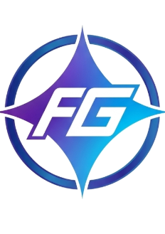
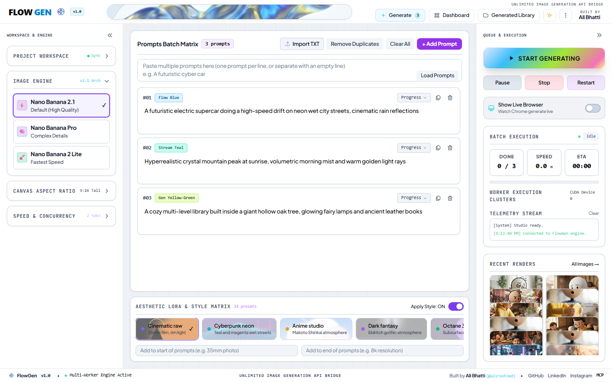
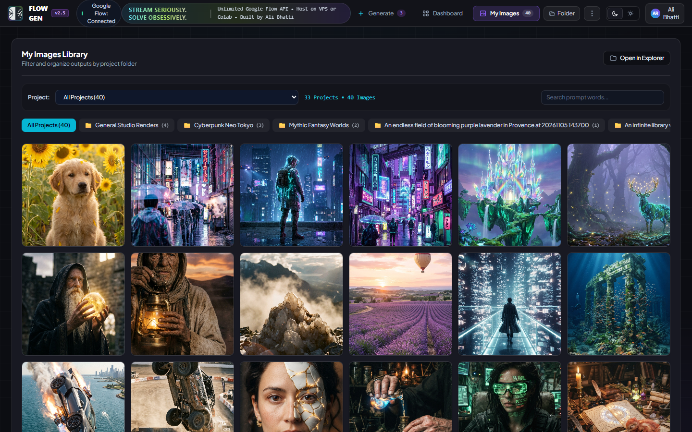
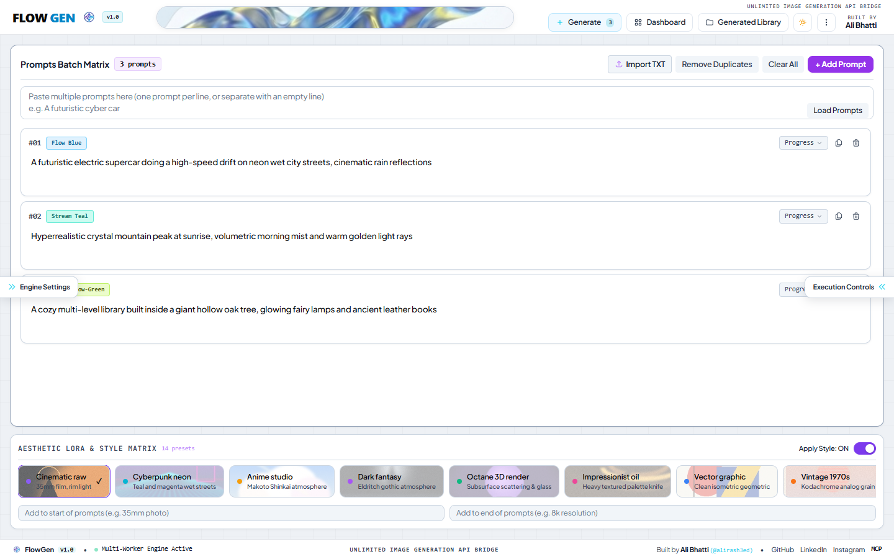
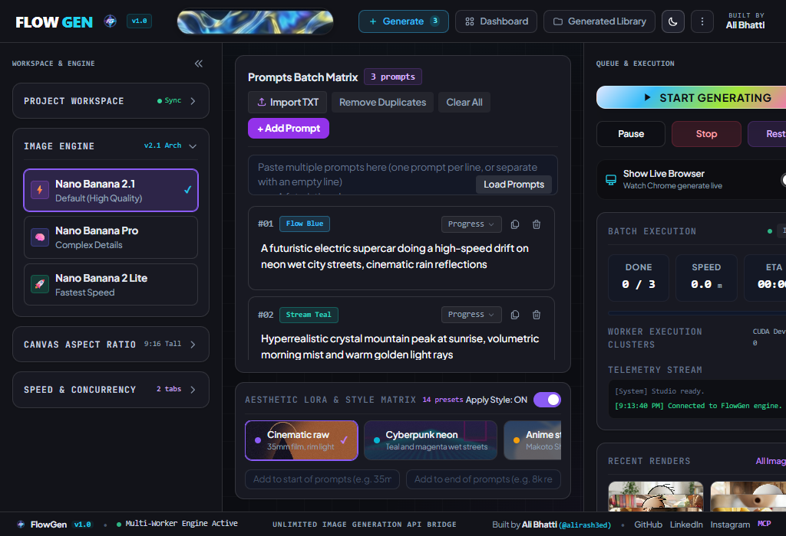

<p align="center">
  <picture>
    <source media="(prefers-color-scheme: dark)" srcset="assets/logo.svg">
    
  </picture>
</p>

<p align="center">
  
</p>

<h1 align="center">FlowGen Image Studio</h1>

<p align="center">
  <b>English</b> · <a href="#-how-it-works">Architecture</a> · <a href="#-two-ways-to-use-it">Studio GUI</a> · <a href="#-built-for-agents">Agent MCP</a> · <a href="#-get-started">Quickstart</a> · <a href="#-license-and-credits">Credits</a>
</p>

<p align="center">
  <b>Turn your Google Flow account into an unlimited, high-speed batch image generation pipeline.</b><br>
  Parallel Chromium worker tabs, zero-overwrite sequential naming, 14 aesthetic styles, a modern zero-scroll cockpit,<br>
  and a native Model Context Protocol (MCP) server for AI coding agents.
</p>

<p align="center">
  
  
  
  
  
  <a href="https://colab.research.google.com"></a>
  <a href="https://github.com/AliRash3ed"></a>
</p>

---

<p align="center">
  
</p>

---

## 💡 Why FlowGen?

Commercial image generation APIs charge steep monthly subscriptions and per-image metering (\$0.04 to \$0.12 per generation), while consumer browser interfaces force you to manually type, wait, copy, and paste one image at a time.

**FlowGen bridges this gap completely for free:**
1. Connects your existing browser account via Chrome DevTools Protocol (CDP).
2. Spawns parallel Chromium worker tabs to run multiple prompts concurrently (2x to 4x speedup).
3. Automates sequential downloading with zero image overwrites.
4. Serves as a native **Model Context Protocol (MCP)** endpoint so agents like **Cursor**, **Claude Desktop**, and **Antigravity** can generate assets autonomously.
5. Runs anywhere: on your local PC, on a cloud VPS via Docker, or 100% free on **Google Colab** with Cloudflare tunnels.

---

## ⚡ How it works

Paste your prompt list, select an aesthetic style, and press **Start Generating**. FlowGen processes the queue across four discrete phases:

1. **Matrix Ingestion:** Parses raw prompt lines, removes duplicates, and injects selected visual style tokens (e.g. 35mm film, cyberpunk neon, anime studio) with custom prefixes/suffixes.
2. **Parallel Tab Dispatch:** Distributes generation tasks evenly across 1 to 4 isolated Chromium worker tabs via Chrome DevTools Protocol.
3. **Sequential Slugging:** Captures rendered outputs, generates clean sequential file names (e.g. `1. Prompt_Title.png`), and isolates them into dedicated project workspaces.
4. **Library & Telemetry:** Updates the live canvas, logs speed and ETA in real time, and exposes generated images immediately in the Generated Library and to connected AI agents.

<table>
  <tr>
    <td width="50%" valign="top">
      <br>
      <sub><b>Generate Cockpit:</b> Dual collapsible sidebars, 14 aesthetic styles, and live telemetry.</sub>
    </td>
    <td width="50%" valign="top">
      <br>
      <sub><b>Generated Library:</b> Filter by project folder, inspect metadata, and open in Explorer.</sub>
    </td>
  </tr>
</table>

---

## 🎛️ Two ways to use it

### 1. Studio Cockpit (Desktop GUI)
- **Zero-Scroll SaaS Cockpit**: Engineered with modern dark and light foundations, high-contrast typography, and zero vertical window scrolling.
- **Dual Collapsible Docks**: Collapse both the left Engine dock and right Execution dock with one click (`«` / `»`) to maximize screen space for prompt editing.
- **1-Click Windows Launcher**: Double-click [`START_FLOWGEN.bat`](START_FLOWGEN.bat) to launch the studio and automatically open your default browser.
- **Live Telemetry Stream**: Real-time measurement of finished images, images per minute speed, ETA countdown, and active worker tab health.
- **Project Folder Management**: Organize outputs by project name, sync custom directories, and open the active project folder directly in Windows Explorer.

<table>
  <tr>
    <td width="50%" valign="top">
      <br>
      <sub><b>Max Canvas View:</b> Sidebars collapsed with drawer pull tabs for large-scale prompt matrices.</sub>
    </td>
    <td width="50%" valign="top">
      <br>
      <sub><b>Light Theme:</b> Crisp high-contrast zinc/slate design system for bright environments.</sub>
    </td>
  </tr>
</table>

### 2. Headless Agent Engine (MCP & REST API)
- **Model Context Protocol (MCP)**: Native stdio and HTTP/SSE MCP server for autonomous LLMs.
- **REST API**: Standard endpoints for programmatic integration into any backend, Python script, or mobile app.
- **Cloud Run**: Ready to host on Google Colab or remote VPS without a local GPU.

---

## 🤖 Built for agents

FlowGen is built from the ground up for AI coding assistants. By exposing its tools over the **Model Context Protocol (MCP)**, agents in **Cursor**, **Claude Desktop**, and **Antigravity** can write prompts, trigger batch runs, monitor generation progress, and inspect finished image files autonomously.

### Claude Desktop Configuration
Add this to your `claude_desktop_config.json`:

```json
{
  "mcpServers": {
    "flowgen": {
      "command": "python",
      "args": ["E:/Organized/flowgen/browser2api/run_mcp.py"],
      "env": {
        "FLOWGEN_API_KEY": "your_api_key_here"
      }
    }
  }
}
```

### Cursor IDE Configuration
In **Cursor Settings** → **Features** → **MCP Servers** → **Add New MCP Server**:
- **Name:** `flowgen`
- **Type:** `command`
- **Command:** `python E:/Organized/flowgen/browser2api/run_mcp.py`

### Exposed MCP Tools
| Tool Name | Parameters | Description |
| :--- | :--- | :--- |
| `flow_generate` | `prompts`, `model`, `orientation`, `workers`, `style_suffix` | Submits batch generation and returns local file paths |
| `flow_get_status` | _none_ | Returns engine health, worker count, and active queue state |
| `flow_get_history` | _none_ | Returns historical analytics, image count, and daily trends |
| `flow_list_projects` | _none_ | Lists all project folders and generated image counts |
| `flow_list_styles` | _none_ | Returns available visual style presets |
| `flow_auth_status` | _none_ | Verifies active Google Flow session status |

---

## 🔧 Under the hood

FlowGen replaces cumbersome manual web automation with an asynchronous multi-tab orchestration engine:

- **Chrome DevTools Protocol (CDP)**: Interacts with Chromium directly at the protocol level for low-latency element querying, rapid form submission, and deterministic network event tracking.
- **Worker Tab Pool**: Maintains up to 4 concurrent tab contexts inside a shared persistent browser profile, cycling prompts concurrently while avoiding rate limiting.
- **Session Persistence**: Google authentication tokens and cookies are saved in an isolated local directory (`.browser2api/`), meaning you only log in once.
- **Zero-Overwrite Naming Engine**: File slugs are sequentially indexed and sanitized from prompt text to ensure that large batch runs never overwrite previous renders.
- **Cloudflare HTTPS Bridge**: When running on Google Colab or headless Linux, an automated Cloudflare Tunnel exposes port `8787` securely with TLS and an API key.

```
┌─────────────────────────────────────────────────────────────┐
│                    FLOWGEN IMAGE STUDIO                     │
├──────────────────────────────┬──────────────────────────────┤
│      Desktop Web Cockpit     │     AI Agent MCP Server      │
│  (FastAPI + Tailwind + JS)   │   (Claude, Cursor, Agents)   │
└──────────────┬───────────────┴──────────────┬───────────────┘
               │                              │
               ▼                              ▼
┌─────────────────────────────────────────────────────────────┐
│              Orchestrator & Multi-Worker Pool               │
├─────────────────────────────────────────────────────────────┤
│  Worker Tab #1  │  Worker Tab #2  │  Worker Tab #3  │  ...  │
│  (CDP Session)  │  (CDP Session)  │  (CDP Session)  │       │
└──────────────┬──────────────────────────────┴───────────────┘
               │
               ▼
┌─────────────────────────────────────────────────────────────┐
│             Google Flow Image Generation Engine             │
└─────────────────────────────────────────────────────────────┘
```

---

## 🚀 Get started

### Option 1: Windows 1-Click Launch (Recommended)
Simply double-click [`START_FLOWGEN.bat`](START_FLOWGEN.bat) (or run `start.bat`) from the root folder.
The script automatically detects the virtual environment, starts the server on port `8787`, and opens your default browser.

---

### Option 2: Google Colab Cloud Run (Free Cloud GPU)
Run FlowGen completely free without using your local PC:
1. Open [`FlowGen_Colab.ipynb`](FlowGen_Colab.ipynb) in Google Colab.
2. Run the cells to install dependencies and initialize the Cloudflare tunnel.
3. Click your live public HTTPS link and copy the generated `FLOWGEN_API_KEY`.

---

### Option 3: Manual Setup (Windows, macOS, Linux)

Requires **Python 3.11 or newer**.

```bash
# 1. Clone repository
git clone https://github.com/AliRash3ed/flowgen.git
cd flowgen

# 2. Create and activate a virtual environment
python -m venv .venv
# On Windows:
.venv\Scripts\activate
# On macOS / Linux:
source .venv/bin/activate

# 3. Install dependencies & Playwright Chromium
pip install -r requirements.txt
playwright install chromium

# 4. Launch Studio
python browser2api/run_hud.py
```

Open **[http://127.0.0.1:8787](http://127.0.0.1:8787)** in your browser.

---

### Option 4: Docker VPS Deployment

```bash
docker compose up -d
```
The studio will be available at `http://YOUR_SERVER_IP:8787`.

---

## 🎨 Supported Models & Aspect Ratios

### Generation Models
- **Nano Banana 2.1** (`nano_banana_2_1`): Default high-quality photorealistic model with rich textures and balanced composition.
- **Nano Banana Pro** (`nano_banana_pro`): Maximum architectural coherence and complex fine details.
- **Nano Banana 2 Lite** (`nano_banana_2_lite`): Optimized lightweight engine for ultra-fast generation batches.

### Canvas Aspect Ratios
- **9:16 Tall** (1024 × 1792): Fullscreen mobile, vertical reels, and social stories.
- **16:9 Wide** (1792 × 1024): Cinematic desktop wallpapers and landscape key visuals.
- **1:1 Square** (1024 × 1024): Standard profile avatars and square portfolio grids.
- **4:3 Frame** (1408 × 1056): Classic editorial photography and vintage magazine aspect ratio.

---

## 🎭 Aesthetic Style Matrix

FlowGen includes 14 built-in aesthetic presets that can be injected at the beginning or end of your prompts:

| Preset Name | Preview Accent | Signature Visual Injections |
| :--- | :--- | :--- |
| **Cinematic Raw** | `#8b5cf6` Violet | 35mm lens, natural dramatic rim lighting, shallow depth of field, 8k |
| **Cyberpunk Neon** | `#06b6d4` Cyan | Vibrant volumetric neon glow, wet night street reflections, octane render |
| **Anime Studio** | `#f59e0b` Amber | Studio Ghibli & Makoto Shinkai aesthetic, luminous clouds, painterly textures |
| **Dark Fantasy** | `#a855f7` Purple | Eldritch gothic atmosphere, ominous fog, moody chiaroscuro lighting |
| **Octane 3D** | `#10b981` Emerald | Subsurface scattering, translucent materials, chromatic aberration, caustics |
| **Impressionist Oil** | `#ec4899` Pink | Heavy impasto palette knife strokes, rich pigment layers, canvas texture |
| **Vector Graphic** | `#3b82f6` Blue | Clean isometric geometric outlines, vibrant flat colors, minimalist |
| **Vintage 1970s** | `#f97316` Orange | Authentic Kodachrome film grain, warm nostalgic color grade, retro vignette |
| **Photoreal Macro** | `#14b8a6` Teal | Extreme close-up lens, microscopic surface details, water droplet caustics |
| **Editorial Fashion** | `#6366f1` Indigo | High-fashion editorial photography, studio strobe lighting, Vogue aesthetics |
| **Minimalist Architecture** | `#64748b` Slate | Monolithic concrete structures, sharp geometric shadows, clean Brutalism |
| **Watercolor Wash** | `#0ea5e9` Sky | Expressive translucent pigment bleeding, wet-on-wet textured paper |
| **3D Claymation** | `#eab308` Yellow | Handcrafted clay textures, stop-motion plasticine finish, studio lighting |
| **Retrowave Synth** | `#d946ef` Fuchsia | 1980s neon wireframe grid, purple chrome sunset, synthwave aesthetic |

---

## 📁 Repository Structure

```text
flowgen/
├── assets/                  # Studio brand logos, icons, and interface screenshots
│   ├── logo.svg             # Vector dark logo
│   ├── logo-light.svg       # Vector light logo
│   ├── logo.png             # Transparent FG emblem
│   ├── studio_cockpit.png   # Main studio cockpit screenshot
│   ├── studio_collapsed.png # Collapsed sidebars screenshot
│   ├── studio_light.png     # Light theme screenshot
│   └── gallery.png          # Generated library screenshot
├── browser2api/             # Core Python package & GUI engine
│   ├── run_hud.py           # GUI application launcher
│   ├── run_mcp.py           # Model Context Protocol server
│   └── src/browser2api/     # FastAPI server, multiworker pool & scrapers
├── colab_run.py             # Cloudflare tunnel & Colab runner
├── docker-compose.yml       # Container orchestration configuration
├── Dockerfile               # Production container image
├── FlowGen_Colab.ipynb      # 1-Click Google Colab Notebook
├── requirements.txt         # Core Python dependencies
├── START_FLOWGEN.bat        # 1-Click Windows desktop launcher
├── start.bat                # Shortcut launcher
├── CONTRIBUTING.md          # Open-source contribution guidelines
├── SECURITY.md              # Security & local session policy
├── LICENSE                  # MIT License
└── README.md                # Project documentation
```

---

## 👨‍💻 License and credits

Architected & engineered by **Ali Bhatti** ([@alirash3ed](https://github.com/AliRash3ed)).
- **GitHub**: [@AliRash3ed](https://github.com/AliRash3ed)
- **LinkedIn**: [Ali Rasheed](https://www.linkedin.com/in/alirasheedbhatti/)
- **Instagram**: [@this_is_ali_r](https://www.instagram.com/this_is_ali_r/)

Released under the **[MIT License](LICENSE)**. Free for personal, commercial, and research use.
